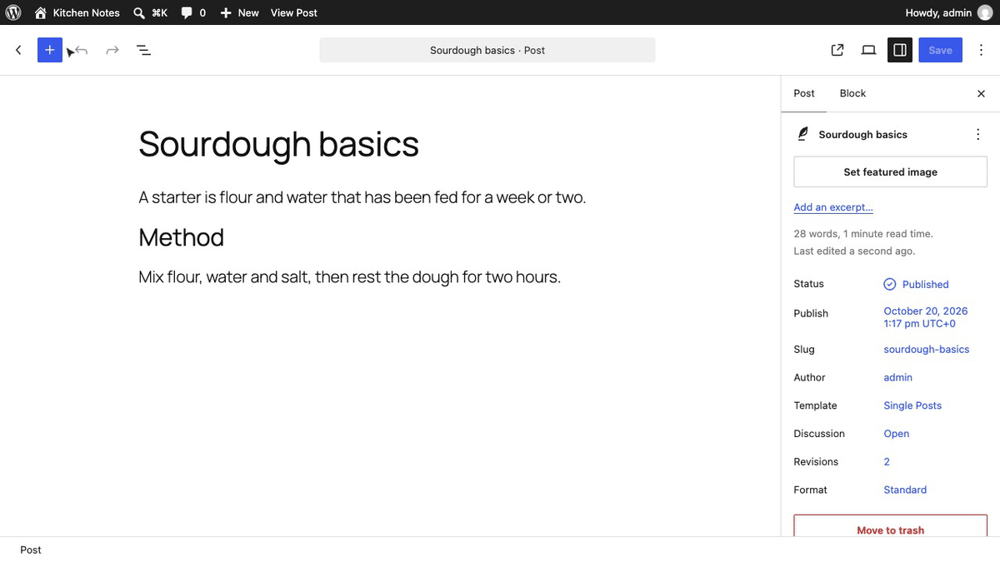
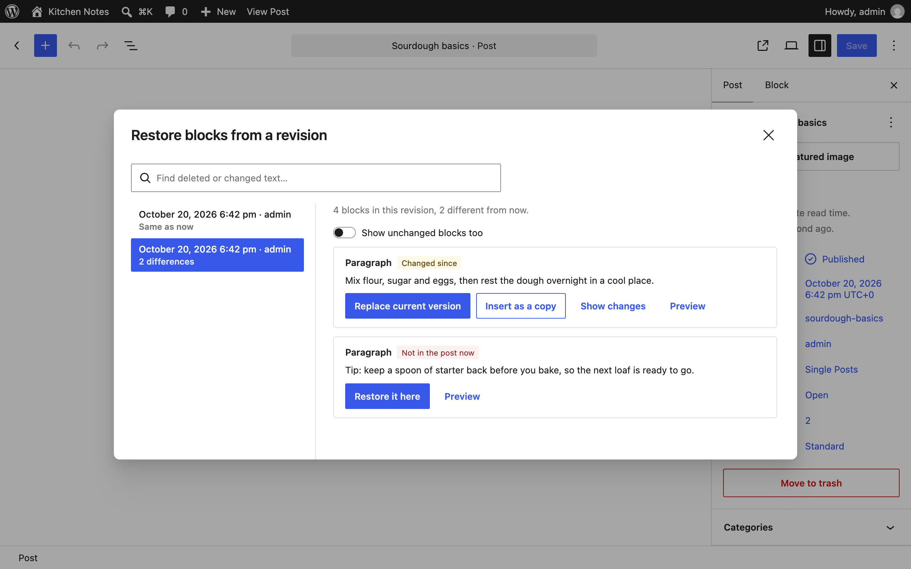
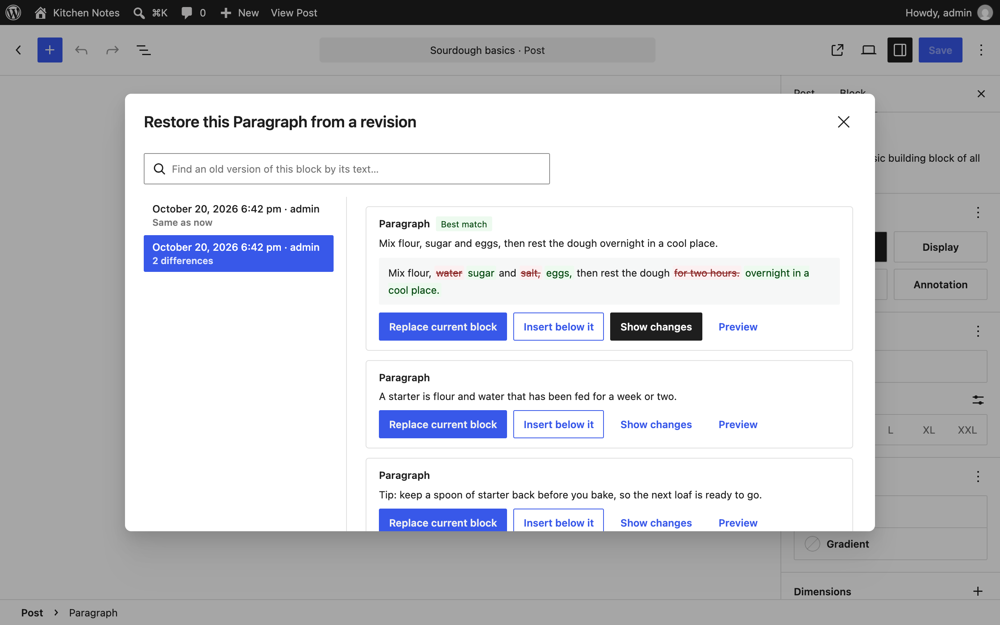
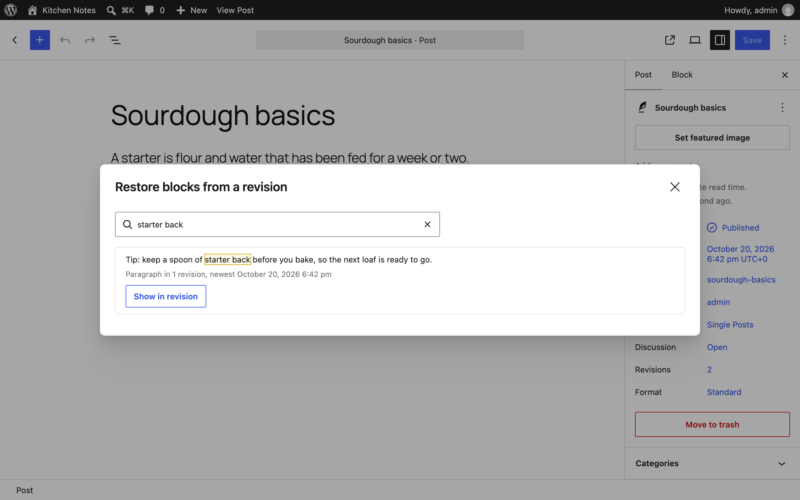

<p align="center"></p>

<h1 align="center">Restore Blocks from Revisions</h1>

<p align="center">
  <a href="https://playground.wordpress.net/?blueprint-url=https://raw.githubusercontent.com/aryanjasala/restore-blocks-from-revisions/main/blueprint.json"></a>
  <a href="https://github.com/aryanjasala/restore-blocks-from-revisions/releases/latest"></a>
  
  
  <a href="LICENSE.md"></a>
  <br>
  <a href="https://github.com/aryanjasala/restore-blocks-from-revisions/actions/workflows/phpcs.yml"></a>
  <a href="https://github.com/aryanjasala/restore-blocks-from-revisions/actions/workflows/phpstan.yml"></a>
  <a href="https://github.com/aryanjasala/restore-blocks-from-revisions/actions/workflows/unit-tests.yml"></a>
  <a href="https://github.com/aryanjasala/restore-blocks-from-revisions/actions/workflows/e2e-tests.yml"></a>
  <a href="https://github.com/aryanjasala/restore-blocks-from-revisions/actions/workflows/plugin-check.yml"></a>
</p>

<p align="center">Restore a single block from an old revision instead of rolling back the whole post.</p>

<p align="center">
  
</p>

---

WordPress revisions are all or nothing. If someone deleted a paragraph last week and the post has been edited ten times since, restoring the revision brings the paragraph back and throws away the ten edits. Restore Blocks from Revisions works inside the editor and restores single blocks, with all their settings, as a normal undoable change.

> [!NOTE]
> Free and open source under the GPL. No pro version, no upsells, no ads in wp-admin, no tracking. And it stays that way.

## Features

- **Block menu > Restore from a revision…**: that block's versions in each revision, best match first
- **Editor menu > Restore blocks from a revision**: every block marked *Same as now*, *Changed since* or *Not in the post now*
- **Restore it here** puts a deleted block back where it was
- **Show changes** highlights the words that differ from the current block
- **Find text in old revisions** searches every revision and jumps to the block that had it
- Revision authors, difference counts, autosaves labelled, arrow-key navigation
- Any block, including blocks from other plugins and blocks inside groups and columns
- Ctrl+Z undoes a restore, and nothing is saved until you update the post

## Install

1. Download `restore-blocks-from-revisions.zip` from the [latest release](https://github.com/aryanjasala/restore-blocks-from-revisions/releases/latest).
2. In WordPress, go to **Plugins > Add New Plugin > Upload Plugin**, choose the zip and activate it.

Or with WP-CLI:

```sh
wp plugin install https://github.com/aryanjasala/restore-blocks-from-revisions/releases/latest/download/restore-blocks-from-revisions.zip --activate
```

Needs WordPress 6.6+ and PHP 7.4+. To try it first, the **Try in WordPress Playground** badge opens a throwaway WordPress in your browser with the plugin and some demo content.

## Quick look

Select a block, open its menu (⋮) and choose **Restore from a revision…**. The closest older version is marked **Best match**, and **Show changes** shows exactly what a restore would change before you click **Replace current block**.

There is no build step and nothing is stored: revisions are read through the REST API with `_fields=content.raw`, so the server never renders them just to list them.

## Screenshots

<table>
  <tr>
    <td width="50%" valign="top"><br><sub>Restoring a deleted paragraph from a revision</sub></td>
    <td width="50%" valign="top"><br><sub>Picking an earlier version of one block, with its changes highlighted</sub></td>
  </tr>
  <tr>
    <td width="50%" valign="top"><br><sub>Finding deleted text across revisions</sub></td>
  </tr>
</table>

## Documentation

| Doc | What it covers |
| --- | --- |
| [Reference](docs/REFERENCE.md) | How matching works, the scripts, and the REST field |
| [Development](docs/DEVELOPMENT.md) | Local setup, commands and tests |
| [Contributing](docs/CONTRIBUTING.md) | Pull requests, required checks and PR titles |
| [Releasing](docs/RELEASING.md) | How merged pull requests become releases |
| [Security](docs/SECURITY.md) | Reporting a vulnerability |
| [readme.txt](readme.txt) | What WordPress.org shows, with the FAQ and changelog |

## Project structure

```
restore-blocks-from-revisions.php     plugin header and PSR-4 autoloader
src/
├── Plugin.php            registers the services, lists supported post types
├── Editor/Assets.php     loads the editor scripts
└── Rest/RevisionAuthor.php  author name on revision REST responses
assets/
├── js/matching.js        matching, diff and search (no WordPress dependency)
├── js/components.js      the restore window
├── js/index.js           the menu entries
└── editor.css
tests/
├── Unit/                 PHPUnit
├── js/                   Node unit tests
└── e2e/                  Playwright specs and the Docker site
.wordpress-org/           screenshots
docs/                     reference, development, contributing, releasing
```

## More free plugins

Small plugins that each fill one gap in WordPress, all free with no pro version:

| | Plugin | What it does |
| --- | --- | --- |
|  | [Page Template Usage](https://github.com/aryanjasala/page-template-usage) | See which template every page uses, and fix the pages on a missing template |
|  | [Staging Guard](https://github.com/aryanjasala/staging-guard) | Stops staging copies from emailing real people or getting indexed |
|  | [Category & Tag Trash](https://github.com/aryanjasala/category-tag-trash) | A trash for categories, tags and custom terms, with undo and full restore |
|  | [Site Read-Only Mode](https://github.com/aryanjasala/site-read-only-mode) | Read-only mode for WordPress during migrations and deploys |

## License

[GPL-2.0-or-later](LICENSE.md) © Aryan Jasala
